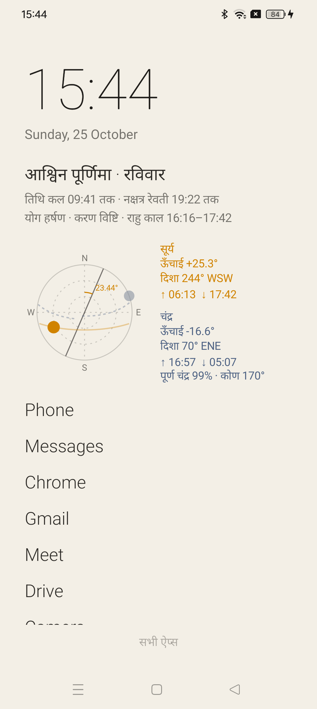
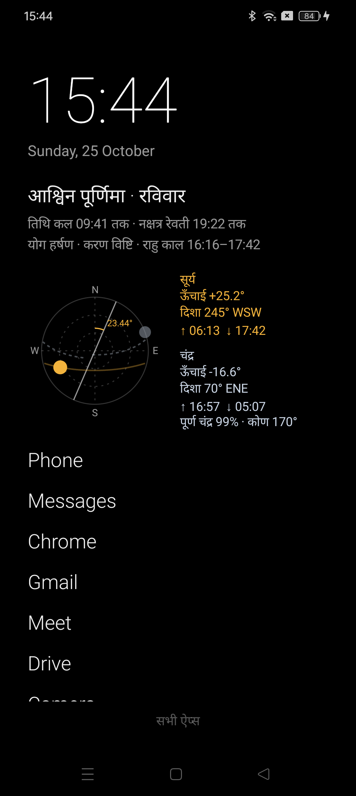
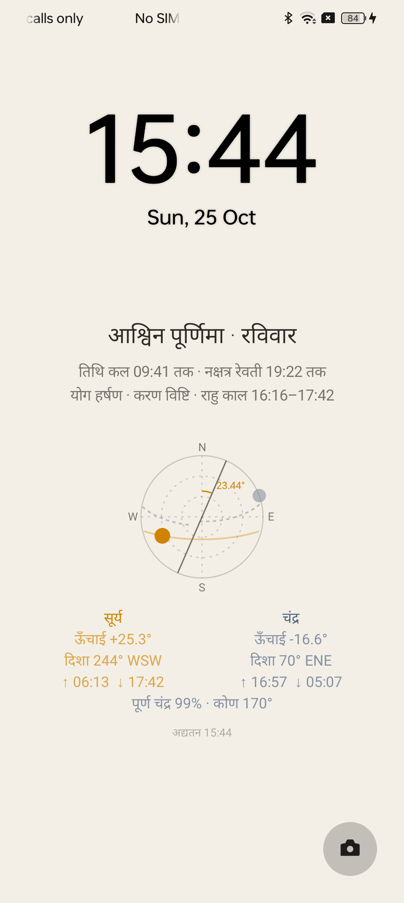
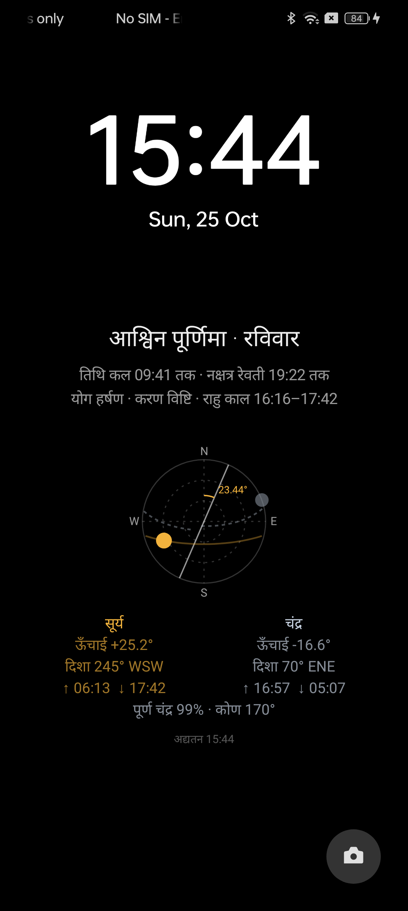

# Minimal Panchang Launcher

A calm, text-only Android home screen and lock screen with a live Hindi Panchang and a sun/moon sky dial,
all computed on the phone for wherever you are. Built for a spare realme phone (ColorOS 14) used for work.

| Home · day | Home · night | Lock · day | Lock · night |
|---|---|---|---|
|  |  |  |  |

## What it shows

- **Panchang** — month (amanta), paksha and tithi as the title; tithi and nakshatra with their end times;
  yoga, karana and rahu kaal. "कल" marks times that fall tomorrow.
- **Sky dial** — a horizon map seen from above (north up, centre = overhead). Today's sun and moon paths are
  drawn faintly and their positions now as dots; the moon dot shows its phase.
- **Earth's tilt** — the dial's N–S line is the vertical; Earth's axis is drawn through the centre at the true
  obliquity for the date (≈23.44°), with the angle labelled.
- **Sun and moon numbers** — altitude, compass bearing, rise and set, moon illumination and elongation.
- **Apps** — a short text list (long-press to add, remove or reorder) and a searchable full list.
- **Day and night** — light look between sunrise and sunset, black at night, switching at the computed times.

The lock screen stays the system one (PIN, clock, unlock). The app draws the Panchang and dial into the lock
wallpaper and redraws it every 15 minutes and whenever the screen turns off.

## Accuracy

Everything is computed on the device with no network or data files: Meeus low-precision series for the sun and
moon, Lahiri ayanamsa, rise/set by scan and bisection. Checked against Swiss Ephemeris, tithi, nakshatra and
yoga end times, sunrise/sunset and moonrise/moonset agree within about a minute, and sun/moon altitude and
azimuth within 0.05°.

Location comes from the phone (coarse, network/fused). With no fix yet it falls back to Varanasi.

## Build and install

Requires JDK 17 and the Android SDK (`local.properties` with `sdk.dir`).

```bash
./gradlew assembleRelease
adb install -r app/build/outputs/apk/release/app-release.apk
```

Then pick **Minimal** as the default home app (Settings → Apps → Default apps → Home app) and allow location.

## realme / ColorOS notes

- **Home button.** ColorOS keeps a hidden "forced default app" list and sends the Home button to its own
  launcher even when another home app is chosen. Minimal ships an accessibility service, **Minimal Home
  button**, that opens Minimal whenever the stock launcher's home screen appears (Recents is left alone).
  Turn it on in Settings → Accessibility → Downloaded apps. If the switch is greyed out, first allow it under
  App info → ⋮ → Allow restricted settings. Reinstalling the app can switch it off again.
- **Lock-screen notifications.** Settings → Notifications & status bar → Lock screen → Lock screen
  notifications → Do not show.
- **Debloat.** `tools/debloat.sh apply` disables the packages in `tools/realme-debloat.txt` (reversible
  `pm disable-user`, nothing is uninstalled) and silences notifications from a set of noisy apps.
  `tools/debloat.sh restore` undoes it.

## Screenshots in a fixed theme

Debug builds accept a theme override, used for the images above:

```bash
adb shell am start -n com.avinash.minimal/.MainActivity --es theme night   # day | night | auto
```

## License

MIT
